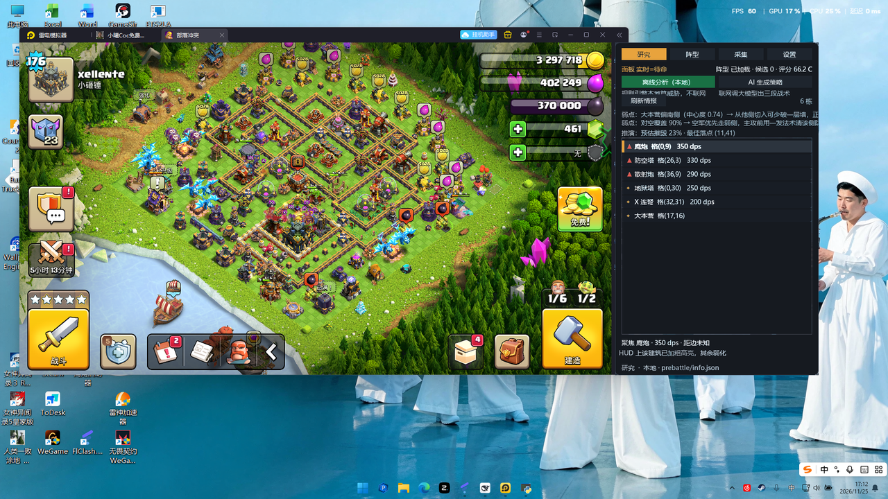

# ClashLab · Clash of Clans overlay

**Out-of-process · zero injection · screen only** — reconnaissance screenshot → map calibration → layout scoring → pre-battle brief → tactical marks, one reproducible pipeline.

[中文](README.md) · [English](README.en.md)

> **100% open source**: code, data and docs in this repo, MIT, no telemetry, no server, no account, no game injection.

## What it is

A translucent overlay for the LDPlayer emulator: reads the screen, computes, draws. No injection, no memory reading, no game-server calls — results come from pixels plus local computation.

| Capability | Description |
|---|---|
| HUD / PANEL | on-screen marks (click-through) or a 440px side panel |
| Calibration | 44x44 DLT homography, auto re-calibration on >10% window change |
| Layout scoring | 7 weighted metrics -> 0-100 + S/A/B/C/D/F with weak-point directions |
| Weak points to tactics | TH bias / air / ground coverage feed the brief |
| Giant-arrow diagram | deployment ring + arrow paths + numbered air defenses (PNG) |
| 2D simulation | candidate drop points with estimated destruction, cached |
| Pre-battle brief | rule engine, optional LLM review |
| Wargame + spawn lines | deterministic tick + Monte Carlo; line deployment 17.9% -> 24.7% |
| OCR + API | screenshot -> opponent name/clan -> ClashKing API TH / war members |
| Android annotator | offline annotation app, export JSON |

## Quick start

`powershell
python -m pip install -r requirements.txt
python run_overlay.py --show --mode PANEL --always-on-top --allow-primary
`

Standalone exe: `dist/ClashOverlay.exe` (bundled OCR, `--ocr-selftest IMAGE OUT.json`).

## Docs

- [Wargame](docs/WARGAME.md) · [Strategy](docs/STRATEGY.md) · [Spawn lines](docs/DEPLOY.md)
- [TH1-TH19 support](docs/TH_SUPPORT.md) · [Levels](docs/LEVELS.md)
- [QA e2e](docs/QA_E2E.md) · [OCR opponent](docs/OCR_OPPONENT.md) · [Android app](docs/ANDROID_APP.md)
- [Recognition decision](docs/RECOG_DECISION.md) · [ML feasibility](docs/ML_FEASIBILITY.md)

## Known limitations

- Recognition: type classification 0.879 / cross-base 0.820 on given crops; detection still unusable (0.06-0.16 per-building hit);
- Walls: automatic extraction not proven, two scoring metrics are N/A;
- Platform: Windows + LDPlayer 1280x720 only.

## License

MIT (see LICENSE); metrics ported from clash-blueprint-engine (MIT); cross-check references clash-of-clans-base-validator (MIT). Game art belongs to Supercell; not affiliated.
