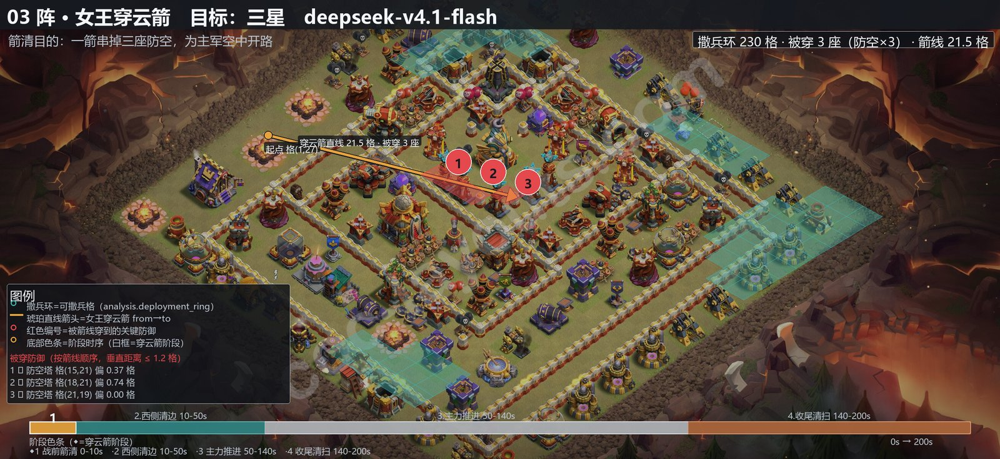

<div align="center">

# ClashLab · An LLM-assisted Clash of Clans base-layout research tool

**Out-of-process · zero injection · screen-only** — a reproducible pipeline: *scout screenshot → homography calibration → layout score → pre-battle brief → tactical annotations*.

[](LICENSE)
[](requirements.txt)
[]()
[]()

[中文](README.md) · [English](README.en.md)

</div>

> **100% open source**: code, data and docs live in this repo under MIT. No telemetry, no server, no account, no game injection.


## ✨ Features

| Feature | Details |
|---|---|
| 🖥 HUD / PANEL | Click-through HUD annotations; 440-px side panel (research / layout / collect / settings) |
| 🎯 Calibration | 44×44 grid, DLT homography, auto re-calibration on >10% window resize |
| 📊 Defense score | 7 weighted metrics → 0–100 with S/A/B/C/D/F grade |
| 🧠 Weak points | TH bias / air / ground coverage → briefing, LLM prompt, panel |
| 🏹 Giant-arrow diagram | Spawn ring + arrow + skewered air defenses + phase bar as PNG |
| 🗺 2D simulation | Candidate spawn points and predicted destruction, cached in panel |
| 🧾 Pre-battle brief | Rule engine first, optional LLM review (never guesses) |

## 🖼 Screenshots

| Tactical diagram | PANEL |
|---|---|
|  |  |

## 🚀 Quick start

```powershell
git clone https://github.com/<your-name>/clashlab-overlay.git
cd clashlab-overlay
python -m pip install -r requirements.txt
python run_overlay.py --show --mode HUD --always-on-top --run-seconds 8
python -m unittest discover -s tests   # 86 tests
```

Tutorial: [docs/教程.md](docs/教程.md) (Chinese).

## 🧩 Architecture

```text
LDPlayer window ──PrintWindow──▶ frame + homography ──▶ analysis (score / ring / sim)
                                                        │
                                            ImGui overlay (HUD/PANEL) + PNG diagrams
```

## ⚠️ Known limitations

- Recognition: 27-px same-zoom accuracy 0.523; detection not usable;
- Wall extraction not validated → compartment / wall metrics are N/A;
- Vision LLM: good at OCR (4/4), poor at building classification (3/16);
- Verified only on Windows + LDPlayer at 1280×720.

## 🔒 Privacy

No injection, no memory reading, no game-server connection. No keys in the repo; LLM credentials come from local config or environment variables.

## 🙏 Acknowledgements & sources

Full list (what was borrowed, from whom, where it landed, license) in **[ATTRIBUTIONS.md](ATTRIBUTIONS.md)**.

- [@koniz-dev](https://github.com/koniz-dev) · [clash-blueprint-engine](https://github.com/koniz-dev/clash-blueprint-engine) (MIT) — 7-metric defense scoring and weak-point model;
- [@Peter537](https://github.com/Peter537) · [clash-of-clans-base-validator](https://github.com/Peter537/clash-of-clans-base-validator) (MIT) — geometry validation, footprint catalogue, 2x2 spell-tower evidence;
- [@ClashKingInc](https://github.com/ClashKingInc) ClashKingAssets, [@chiefpansancolt](https://github.com/chiefpansancolt), [@Statscell](https://github.com/Statscell) — asset/data references;
- Clash of Clans Wiki (Fandom) — per-stat source URLs in assets.py.

## 📄 License & credits

- This project: **MIT** (see LICENSE);
- Scoring metrics ported from [clash-blueprint-engine](https://github.com/koniz-dev/clash-blueprint-engine) (MIT);
- Cross-checked with [clash-of-clans-base-validator](https://github.com/Peter537/clash-of-clans-base-validator) (MIT);
- Assets follow the Supercell Fan Content Policy; Clash of Clans is a Supercell trademark.

## ⚖️ Disclaimer

For learning and research only. Follow Supercell's Terms of Service; use at your own risk.
