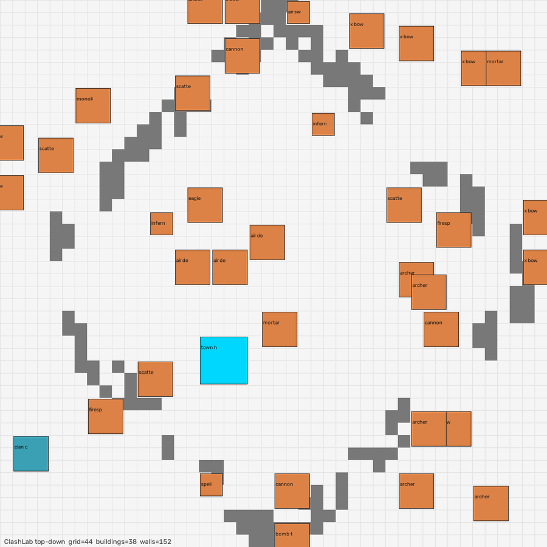

# Tutorial · from install to output

> Works on Windows 10/11 with LDPlayer 9 and Python 3.13. Chinese version: [教程.md](教程.md).

This guide goes install → run → read the panel → produce output, and each step comes with a quick way to check it worked. If you just want to see something on screen, sections 1 to 3 are enough; the rest covers scoring, layout data and troubleshooting.

## 1. Install

```powershell
python -m pip install -r requirements.txt   # numpy / opencv / pywin32 / imgui_bundle / pillow
```

## 2. Get the emulator to 1280×720

- In LDPlayer 9, set the resolution to **720×1280 with DPI 320**. Once the game goes landscape the client area is exactly **1280×720**.
- On multi-monitor setups the overlay deliberately refuses the primary display. Move the emulator to the secondary screen, or pass `--allow-primary` for a one-off run.

## 3. First self-check

```powershell
python run_overlay.py --show --mode HUD --always-on-top --run-seconds 8
```

Then check the log at `out/overlay/overlay.log`. If you see `target_rect=...`, `rect=(x,y,1280x720)`, `fps summary` and `runtime end`, then window discovery, calibration and rendering all work. If one of those lines is missing, it usually tells you which step broke.

## 4. Modes

| Mode | Command | Use |
|---|---|---|
| HUD | `--mode HUD` | annotations, click-through |
| PANEL | `--mode PANEL` | 440 px side panel with four pages |

Other options: `--always-on-top`, `--run-seconds N` (exit after N seconds) and `--allow-primary` (temporarily allow the primary display).

## 5. What the panel shows

- **Research**: the status line reads `score 66.2 C`; below it are two finding lines (for example `TH south bias`, `air 90%`), then `simulation: 23% predicted · best spawn (11,41)`. Clicking an entry in the defence list highlights that building in the HUD.
- **Layout**: candidate canvas, run study, score line at the bottom.
- **Collect / Settings**: auto capture, hotkeys and parameters.

## 6. Reading the score

Seven metrics are weighted, total weight 13: TH 3, storage 2, air 2, ground 2, compartment 2, walls 1, entry 1. The score is rescaled to 0–100 and graded S≥90, A≥80, B≥70, C≥55, D≥40.

Compartment and wall metrics show N/A until wall data is complete; the other five are usable.

## 7. Layout data

The overlay reads `layouts/layout_current.json`. The minimal form is:

```json
{"name":"03","grid":44,"buildings":[{"type":"town-hall","tile":[17,28]}],"walls":[[12,20]]}
```

To try it quickly, copy one of the bundled layouts: `copy bases\th16\03\layout.json layouts\layout_current.json`.

## 8. LLM (optional)

The rule engine runs offline; you get scoring and tactics without a model. To enable an LLM, either use `provider_sources` in `~/.astrbot/data/cmd_config.json` on your machine, or set the `CLASHLAB_BASE`, `CLASHLAB_KEY` and `CLASHLAB_MODEL` environment variables. No keys are shipped.

## 9. Commands

```powershell
python -m clashlab.prebattle --layout bases\th16\03\layout.json --out out\prebattle
python -m clashlab.overlay.giant_arrow_diagram --layout bases\th16\03\layout.json --out out\ga.png
.\build_overlay.ps1                    # build the exe
python -m unittest discover -s tests    # all green
```

## 10. 2D export

```powershell
python -m clashlab.topdown_cli --layout bases\th16\03\layout.json --out out\overlay\_2d
```

It writes two files: `03_topdown.png` (44×44 top-down view with defences in orange, Town Hall in cyan, resources in green and walls in grey) and `03_2d.json` (tile coordinates, category and size, ready for a 2D engine).



## 11. Semi-automatic annotation (recommended first)

```powershell
python tools/annotate/start.py        # http://127.0.0.1:8765, opens the browser
```

- Bases are grouped by TH (TH16: 01–06); each base is **pre-filled** from layout.json, so you only drag wrong boxes to the right tile and fix wrong types.
- Keys: `1`–`9` pick type, `Tab` next building, arrows nudge, `Delete` remove, `Backspace` undo, `Enter` save & next base, `Space` save & skip, `Q/E` switch candidate, `PageUp/PageDown` change base.
- Auto-saves to `out/annotate/NN_annotated.json` (same schema as layout.json); summary in `out/annotate/summary.json`.
- Annotations feed training directly: `python tools/train_from_annotations.py --layouts "bases/th16/*/layout.json" "out/annotate/*.json"`.

## 12. Wall symmetry completion

```powershell
python -m clashlab.wall_symmetry_cli --layout bases\th16\03\layout.json --out out\walls
```

Infers left-right / up-down / 180° symmetry from building positions, mirrors missing wall cells, and separates the main wall component from isolated wall segments.

## 13. Troubleshooting

| Symptom | Fix |
|---|---|
| `target on primary display` in the log | move the emulator to the secondary screen, or pass `--allow-primary` |
| no score shown | `layouts/layout_current.json` is missing |
| marks are offset | resizing the window triggers recalibration; you can also recalibrate manually in settings |
| exits immediately | check `out/overlay/overlay.log` |
| CJK text shows as boxes | install Microsoft YaHei |

If you have annotated layouts or cleaned-up data you would like in the repo, submit them the way the "Community" section of the README describes.
