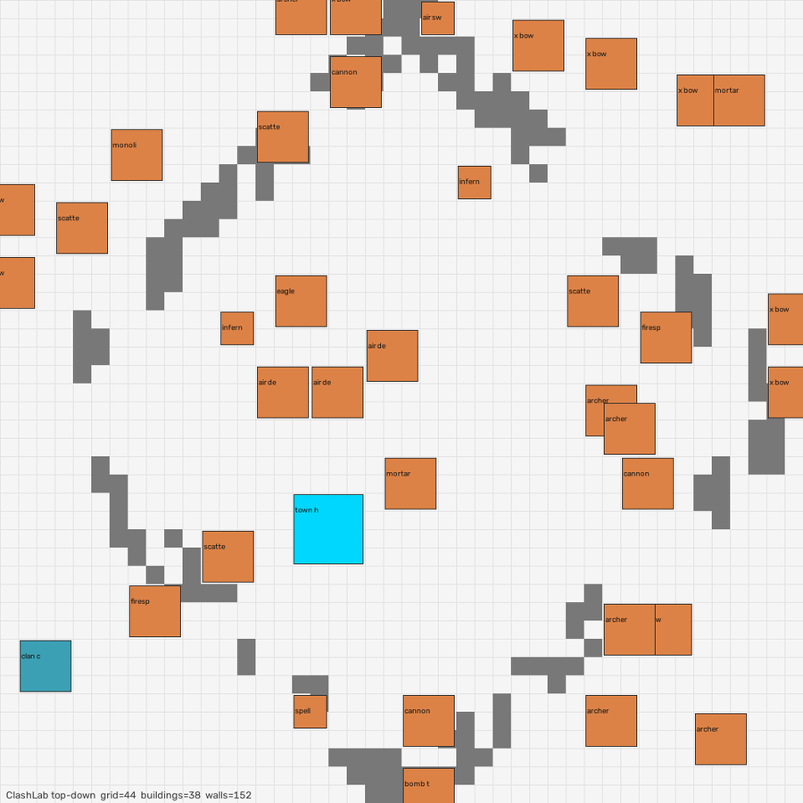

# 教程 · 从装好到出图

> 适用环境：Windows 10/11、雷电模拟器 9、Python 3.13。英文版看 [TUTORIAL_en.md](TUTORIAL_en.md)。

这篇按「装 → 跑 → 看懂面板 → 出图」的顺序走，每一步都顺手给了确认方法。只想先看到东西的话，做完第 1 到第 3 节就够了；后面是评分口径、阵型数据和排障。

## 1. 装依赖

```powershell
python -m pip install -r requirements.txt   # numpy / opencv / pywin32 / imgui_bundle / pillow
```

## 2. 把模拟器调成 1280×720

- 雷电 9 里把分辨率设成 **720×1280、DPI 320**，游戏切横屏之后客户区正好是 **1280×720**。
- 多显示器时覆盖层默认不进主屏，这是故意的：要么把模拟器拖到副屏，要么临时加 `--allow-primary`。

## 3. 首次自检

```powershell
python run_overlay.py --show --mode HUD --always-on-top --run-seconds 8
```

跑完看 `out/overlay/overlay.log`：出现 `target_rect=...`、`rect=(x,y,1280x720)`、`fps summary`、`runtime end` 就说明找窗、标定、渲染都正常了。少哪一行，基本就能顺着定位到哪一步。

## 4. 两种模式

| 模式 | 命令 | 用途 |
|---|---|---|
| HUD | `--mode HUD` | 画面标注，鼠标穿透 |
| PANEL | `--mode PANEL` | 右侧 440 宽面板，四页 |

另外几个参数：`--always-on-top`（常显）、`--run-seconds N`（N 秒后退出）、`--allow-primary`（临时允许主屏）。

## 5. 面板里看什么

- **研究页**：状态栏是一行 `评分 66.2 C`；下面是两行弱点（例如 `大本营偏南`、`对空 90%`）；再往下是 `推演：预估摧毁 23% · 最佳落点 (11,41)`。点防御列表里的条目，HUD 上会高亮对应的建筑。
- **阵型页**：候选画布、触发研究、底部评分。
- **采集页 / 设置页**：自动采集、热键和参数。

## 6. 评分怎么读

7 个指标加权，权重合计 13：大本营保护 3、资源仓 2、对空 2、对地 2、隔间 2、墙体 1、入口 1。分数换算成 0–100 之后按 S≥90、A≥80、B≥70、C≥55、D≥40 分级。

隔间和墙体两项因为墙数据没补全，现在固定显示 N/A；其余五项可用。

## 7. 阵型数据

覆盖层读的是 `layouts/layout_current.json`，最小结构长这样：

```json
{"name":"03","grid":44,"buildings":[{"type":"town-hall","tile":[17,28]}],"walls":[[12,20]]}
```

想快一点体验，直接把仓库里的阵型拷过去：`copy bases\th16\03\layout.json layouts\layout_current.json`。

## 8. 大模型（可选）

规则引擎可以离线跑，不接模型也能出评分和战术。要接 LLM 的话，两条路：本机 `~/.astrbot/data/cmd_config.json` 里的 `provider_sources`，或者环境变量 `CLASHLAB_BASE` / `CLASHLAB_KEY` / `CLASHLAB_MODEL`。仓库里不含密钥。

## 9. 常用命令

```powershell
python -m clashlab.prebattle --layout bases\th16\03\layout.json --out out\prebattle
python -m clashlab.overlay.giant_arrow_diagram --layout bases\th16\03\layout.json --out out\ga.png
.\build_overlay.ps1                    # 打 exe
python -m unittest discover -s tests    # 全部通过即可
```

## 10. 2D 化

```powershell
python -m clashlab.topdown_cli --layout bases\th16\03\layout.json --out out\overlay\_2d
```

输出两个文件：`03_topdown.png`（44×44 俯视图，防御橙色、大本营青色、资源绿色、墙体灰色）和 `03_2d.json`（tile 坐标 + 类别 + 尺寸，供 2D 引擎导入）。



## 11. 半自动标注（推荐先做这个）

```powershell
python tools/annotate/start.py        # 默认 http://127.0.0.1:8765，自动开浏览器
```

- 按 TH 分组（当前 TH16：阵 01–06），每阵用 layout.json **预填**；你只需把位置不对的方框拖到正确格子、把类型不对的改一下；
- 快捷键：`1`–`9` 选类型，`Tab` 下一栋，方向键微调，`Delete` 删除，`Backspace` 撤销，`Enter` 保存并下一阵，`Space` 保存并跳过，`Q/E` 切候选方案，`PageUp/PageDown` 换阵；
- 改动后 1.2 秒自动保存到 `out/annotate/NN_annotated.json`（与 layout.json 同 schema），汇总在 `out/annotate/summary.json`；
- 标好的数据直接进训练：`python tools/train_from_annotations.py --layouts "bases/th16/*/layout.json" "out/annotate/*.json"`。

## 12. 城墙对称补全

```powershell
python -m clashlab.wall_symmetry_cli --layout bases\th16\03\layout.json --out out\walls
```

按建筑分布推断左右/上下/180° 对称，把漏标的墙线镜像补齐；同时区分主城墙（最大连通分量）与独立墙段（一般不影响强度）。

## 13. 从游戏导入新阵（游戏内点开链接）

    python tools/import_base.py --th 16 --id 07

在模拟器里先把分享链接点开、进到阵型预览画面，再运行上面命令（默认用 ADB 截屏；也可 --from-file 截图.png）：

- 自动检测草地边界做 44×44 标定，输出 bases/th16/07/base.png 和 layout_draft.json；
- 标定口径：44×44 指整张地图的 44 格，四角取地图最外圈格的边界，不是最外侧建筑或墙；
- out/import/07_grid.png 是标定可视化，先肉眼确认网格贴合；
- 标定面积只占画面很小比例时会提示 WARN（说明截的不是游戏内村庄画面）；
- 想用相近阵型预填建筑：加 --copy-from bases/th16/03/layout.json；
- 随后 python tools/annotate/start.py 微调草稿即可。


## 13. 排障

| 现象 | 处理 |
|---|---|
| 日志里 `target on primary display` | 把模拟器拖到副屏，或临时加 `--allow-primary` |
| 不显示评分 | 缺 `layouts/layout_current.json` |
| 标注位置偏移 | 改窗口尺寸会自动重标定；也可以去设置页手动标 |
| 启动就退出 | 看 `out/overlay/overlay.log` |
| 中文显示成方块 | 装微软雅黑 |

自己标好的阵型或整理好的数据想进仓库，按 README 里「社区维护」一节的方式提交就行。
